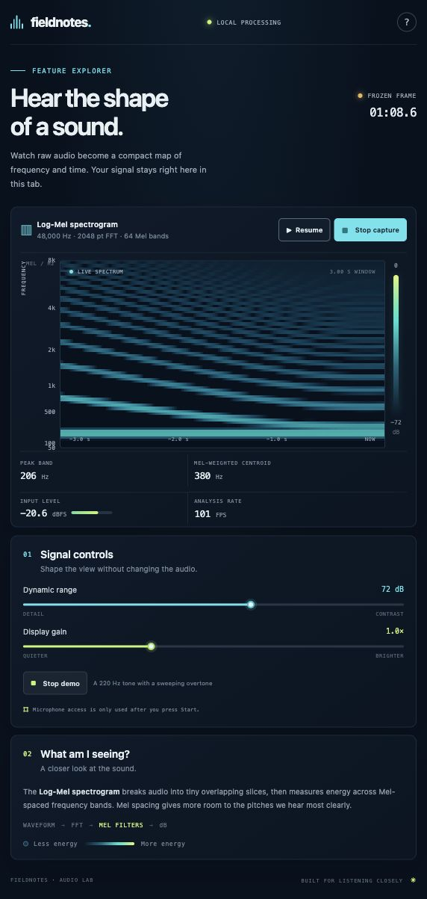

# Log-Mel Playground

A browser playground for seeing how audio becomes a log-Mel spectrogram. Explore a generated tone and sweeping overtone, or use your microphone to compare speech, humming, clapping, and other sounds.



Audio is processed locally in an AudioWorklet. It is not recorded or uploaded. The app has no backend, npm dependencies, build step, or API keys.

## Run locally

You need Python 3 and a modern browser with AudioWorklet support.

```bash
git clone https://github.com/tbarbugli/log-mel-playground.git
cd log-mel-playground
python3 -m http.server 8765 --bind 127.0.0.1 --directory dist
```

Open [http://127.0.0.1:8765](http://127.0.0.1:8765). Press **Try a demo signal** to explore without microphone permission, or **Start microphone** to capture your input. Press **Stop capture** when finished.

If you have Node.js installed, `npm start` runs the same local server. If port 8765 is already in use, choose another port in the Python command and open that port instead.

Microphone access and AudioWorklet need a secure context. Localhost works; a remotely hosted copy needs HTTPS. Serve the app through HTTP rather than opening `index.html` as a file. If an embedded browser blocks microphone access, open the localhost address in your regular browser.

## Explore the app

- **Spectrogram:** time moves horizontally; Mel-spaced frequency bands run vertically. Brighter colors mean greater band power.
- **Freeze:** pause the view to inspect a pattern while capture continues.
- **Dynamic range and display gain:** adjust the visualization without changing the analyzed audio.
- **Readouts:** inspect the peak band, Mel-weighted spectral centroid, input level in dBFS, and analysis rate.
- **Demo signal:** a 220 Hz tone with a sweeping overtone makes stable and changing frequency patterns visible.

The colors show relative digital power, not calibrated sound pressure. This is a signal-processing explorer, not a trained sound classifier.

## How it works

```text
Microphone or generated signal
    → overlapping Hann-windowed audio frames
    → real-time FFT power
    → 64 triangular Mel filters
    → logarithmic power
    → scrolling canvas visualization
```

The frontend uses the actual AudioContext sample rate, a 2,048-sample periodic Hann window, and a radix-2 FFT. Frames begin approximately every 10 ms. Mel filters cover 50 Hz to the smaller of 8 kHz and Nyquist. FFT power is normalized by the FFT size squared, pooled by the filters, and converted using `10 * log10(max(power, 1e-12))`.

`dist/dsp.js` contains the DSP, `dist/log-mel-processor.js` runs it in the audio worklet, and `dist/app.js` handles controls and drawing. Everything under `dist/` is ready to serve as static files.

## Run the tests

Node.js 20 or later is required. No package installation is needed.

```bash
npm test
```

The ten tests compare the FFT with an independent direct DFT, verify window gains and filter support, locate a known tone at several sample rates, check amplitude-to-power scaling, and exercise exact frame timing and capture cleanup.
